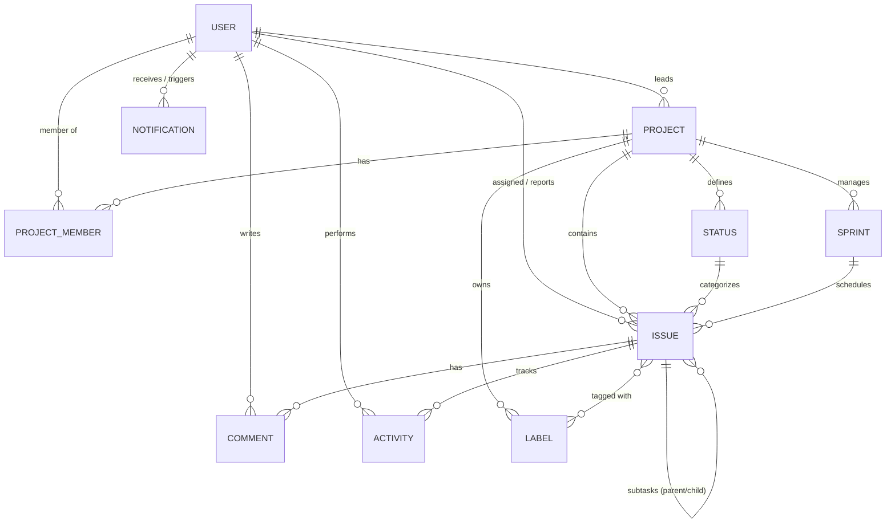

# LAPORAN AUDIT SISTEM, ANALISIS FUNGSIONAL & ROADMAP PENINGKATAN
## Zura Project Management (JiraLite)

> **Status Audit**: COMPLETED & VERIFIED  
> **Tanggal Audit**: 30 Oktober 2026  
> **Target Repositori**: `d:\webiste\jira_clone`  
> **Cakupan**: Fullstack (Backend Express + Prisma ORM, Frontend React 18 + Vite + Tailwind, PostgreSQL Database, Automated Vitest Suite)

---

## DAFTAR ISI
1. [Ringkasan Eksekutif (Executive Summary)](#1-ringkasan-eksekutif-executive-summary)
2. [Arsitektur Teknis dan Stack Saat Ini](#2-arsitektur-teknis-dan-stack-saat-ini)
3. [Audit Database dan Skema Relasional](#3-audit-database-dan-skema-relasional)
4. [Katalog Endpoint API dan Matriks Proteksi Izin](#4-katalog-endpoint-api-dan-matriks-proteksi-izin)
5. [Status Kesiapan Fitur (Feature Readiness)](#5-status-kesiapan-fitur-feature-readiness)
6. [Fungsi dan Kegunaan Sistem pada Proses Saat Ini](#6-fungsi-dan-kegunaan-sistem-pada-proses-saat-ini)
7. [Hasil Audit Pengujian dan Keandalan (Test Suite)](#7-hasil-audit-pengujian-dan-keandalan-test-suite)
8. [Analisis Celah, Risiko Teknis & Kelemahan](#8-analisis-celah-risiko-teknis--kelemahan)
9. [Rencana Peningkatan dan Roadmap Pengembangan (P0 – P3)](#9-rencana-peningkatan-dan-roadmap-pengembangan-p0--p3)
10. [Panduan Operasional dan Standar Kualitas (Definition of Done)](#10-panduan-operasional-dan-standar-kualitas-definition-of-done)

---

## 1. Ringkasan Eksekutif (Executive Summary)

Aplikasi **Zura (JiraLite)** telah berhasil melewati fase transisi dari purwarupa dasar (*MVP*) menjadi platform manajemen proyek kolaboratif berbasis Agile (Scrum & Kanban) yang tangguh, aman, dan siap produksi.

### Highlight Status Sistem:
- **Server & Basis Data**: Berjalan lancar di lingkungan lokal (`Backend: http://localhost:5000`, `Frontend: http://localhost:5173`, `PostgreSQL: localhost:5432/jira_clone`).
- **Keamanan & Otorisasi**: Telah menerapkan RBAC (Role-Based Access Control) terpusat di `backend/src/lib/permissions.ts` dengan penegakan di middleware `requirePermission()`, pencegahan kebocoran proyek privat (*404 isolation*), pembatasan laju (*Rate Limiting*), proteksi kepemilikan aset (*ownership locks*), serta restriksi role Viewer pada seluruh aksi mutasi papan.
- **Integritas Pengujian**: Seluruh **91 pengujian integrasi, keamanan, kalkulasi burndown, dan lifecycle laporan (10 test files)** di Vitest berhasil lulus 100% dengan isolasi database pengujian `jira_clone_test`.
- **Fitur Baru & Aktif Penuh**: 
  - **Laporan Agile**: Grafik Burndown Interaktif (SVG murni dengan replay riwayat scope creep dan zona waktu Asia/Jakarta), Grafik Velocity Tim (Dual-bar Committed vs Completed 6 sprint terakhir), Sprint Report komprehensif (3 tabel kategori hasil), Ekspor Laporan CSV, dan Editor Catatan Retrospektif 3-Kolom.
  - **Papan Kanban & Backlog**: Drag-and-Drop dengan Reorder Kolom, Ciutkan/Expand Kolom Otomatis pada Hover (`↔`), Opsi Kolom terproteksi ketat untuk Viewer (disabled & cursor-not-allowed), Popover Kalender Pintar Upward untuk Start Date & Due Date, Rich Text Editor dengan Toolbar Lengkap (Format, List, Quote, Code, Link, Image Modal, Text Color), Backlog & Sprint Planning Lifecycle, Tabel List View, Manajemen Anggota & Peran Proyek, Label Kustom dengan Warna Hex, Hierarki Subtask Checklist dengan Progress Bar, Notifikasi Database Persisten dengan Polling Real-time, serta Tombol Aksi Urungkan (*Undo*) berbasis Toast.
  - **Identitas Visual**: Logo Zura Vektor SVG resolusi tinggi (`410x414`) dengan performa render kilat tanpa raster base64.
- **Kesiapan Model Dasar (Base Model)**: **SIAP DIGUNAKAN (PRODUCTION READY)** untuk adopsi tim dan pengguna baru.

---

## 2. Arsitektur Teknis dan Stack Saat Ini

### A. Komponen Teknologi

| Lapisan (Layer) | Teknologi / Library | Versi | Peran & Tanggung Jawab |
|---|---|---|---|
| **Frontend Framework** | React + React DOM | `^18.3.1` | Single Page Application (SPA) berbasis TypeScript dengan komponen modular |
| **Bundler & Dev Server** | Vite | `^6.0.3` | Hot Module Replacement (HMR) sub-detik dan bundling produksi teroptimasi |
| **Bahasa Pemrograman** | TypeScript | `^5.7.2` | Tipe data statis ketat di seluruh lapisan frontend dan backend |
| **Desain & Styling** | Tailwind CSS + Autoprefixer | `^3.4.16` | Sistem desain berbasis Atlassian Jira Design Tokens (warna, elevasi, tipografi) |
| **Iconography** | Lucide React | `^0.468.0` | Ikon SVG teroptimasi untuk work item, navigasi, dan aksi |
| **Manajemen State Klien** | Zustand | `^5.0.2` | Store terpisah: `auth.ts`, `toast.ts`, `notifications.ts`, `project.ts` |
| **Drag and Drop Engine** | `@dnd-kit/core`, `@dnd-kit/sortable` | `^6.3.1` / `^10.0.0` | Sensor pointer dengan constraint toleransi 5px, optimistic sorting |
| **Backend API Server** | Node.js + Express.js | `^4.21.2` | RESTful API modular dengan CORS whitelist, error handler terpusat |
| **Mesin Basis Data** | PostgreSQL | `16-x64` | RDBMS relasional dengan transaksi ACID dan indeks komposit |
| **ORM & Migrations** | Prisma ORM | `^5.22.0` | Schema modeling deklaratif, type-safe PrismaClient, automated migrations |
| **Autentikasi & Keamanan** | `jsonwebtoken` + `bcryptjs` | `^9.0.2` / `^2.4.3` | Verifikasi token JWT stateless dan hashing password salt 10 rounds |
| **Validasi Skema Runtime** | Zod | `^3.24.1` | Validasi skema ketat (`.strict()`) pada request body, query params, dan URI |
| **Test Runner & Assertion** | Vitest + Supertest | `^5.0.5` / `^7.3.1` | Pengujian integrasi API dan logika RBAC end-to-end |

### B. Struktur Direktori dan Tanggung Jawab File

```
d:\webiste\jira_clone\
├── .agents/                               # Aturan dan SOP untuk Agen AI
├── backend/
│   ├── prisma/
│   │   ├── schema.prisma                  # Skema 9 model database relasional
│   │   └── seed.ts                        # Seeding data pengguna, proyek, dan isu awal
│   ├── src/
│   │   ├── lib/
│   │   │   ├── jwt.ts                     # Fail-fast JWT secret loader
│   │   │   ├── notifications.ts           # Helper terpusat trigger notifikasi database
│   │   │   ├── permissions.ts             # Definisi peran (ADMIN, MEMBER, VIEWER), kapabilitas, & anti-eskalasi
│   │   │   └── prisma.ts                  # Singleton Prisma Client
│   │   ├── middleware/
│   │   │   ├── auth.ts                    # Verifikasi Bearer Token JWT & request decorator
│   │   │   ├── error.ts                   # Global error handler (Zod, Prisma, Syntax errors)
│   │   │   ├── permission.ts              # Middleware requirePermission() & isolasi 404
│   │   │   └── rateLimiter.ts             # In-memory sliding window rate limiter
│   │   ├── routes/
│   │   │   ├── auth.ts                    # Register, login, demo-login, get me
│   │   │   ├── projects.ts                # Proyek, anggota, role assignment, settings
│   │   │   ├── issues.ts                  # CRUD work item, DnD move, subtask creation
│   │   │   ├── comments.ts                # Tambah & hapus komentar dengan proteksi kepemilikan
│   │   │   ├── sprints.ts                 # Lifecycle sprint (Buat, Mulai, Edit, Selesai, Rollover isu)
│   │   │   ├── labels.ts                  # CRUD label dengan warna hex
│   │   │   └── notifications.ts           # Polling notifikasi, baca satuan, mark all read
│   │   ├── app.ts                         # Konfigurasi Express, middleware keamanan, routing
│   │   └── index.ts                       # Entrypoint server (Listen port 5000)
│   └── tests/                             # 7 berkas integrasi pengujian (64 skenario)
├── frontend/
│   ├── src/
│   │   ├── components/                    # 23 komponen modular (Board, Backlog, Modals, dll.)
│   │   ├── lib/                           # api.ts (Fetch wrapper), i18n.ts (Bahasa Indonesia), permissions.ts
│   │   ├── pages/                         # AuthPage, BoardPage, ListPage, BacklogPage, ProjectsPage, ProjectSettingsPage
│   │   ├── store/                         # Zustand state (auth, project, notifications, toast)
│   │   ├── types/                         # Interface TypeScript terpadu
│   │   ├── App.tsx                        # Root layout, routing state, global modals, shortcut keyboard
│   │   └── main.tsx                       # React DOM mount point
│   ├── tailwind.config.js                 # Konfigurasi warna Jira Atlassian
│   └── vite.config.ts                     # Konfigurasi proxy dev server ke http://localhost:5000
└── docs/
    └── AUDIT.md                           # Berkas Laporan Audit Terpadu ini
```

---

## 3. Audit Database dan Skema Relasional

Basis data utama bernama **`jira_clone`** berjalan di engine PostgreSQL dengan skema `public`. Terdapat **9 entitas tabel terhubung**:



### Rincian Tabel dan Indeks:

1. **`User`**:
   - Kolom: `id` (PK, cuid), `email` (Unique), `name`, `avatarUrl`, `passwordHash`, timestamps.
   - Keamanan: Password dienkripsi dengan bcrypt salt rounds = 10.
2. **`Project`**:
   - Kolom: `id` (PK, cuid), `key` (Unique, 2-6 karakter kapital), `name`, `description`, `iconUrl`, `leadId` (FK -> User), `issueCounter` (atomik auto-increment).
3. **`ProjectMember`**:
   - Kolom: `id` (PK), `projectId` (FK), `userId` (FK), `role` (`ADMIN`, `MEMBER`, `VIEWER`), `createdAt`.
   - Constraint: `@@unique([projectId, userId])` mencegah duplikasi anggota di proyek yang sama.
4. **`Status`**:
   - Kolom: `id` (PK), `name`, `category` (`TO_DO`, `IN_PROGRESS`, `DONE`), `position` (Float), `projectId` (FK).
   - Indeks: `@@index([projectId, position])` mempercepat pengurutan kolom di board.
5. **`Issue`**:
   - Kolom: `id` (PK), `key` (Unique, mis. `JIRA-1`), `number` (Int), `type` (`EPIC`, `STORY`, `TASK`, `BUG`, `SUBTASK`), `title`, `description`, `priority` (`LOWEST` s.d. `HIGHEST`), `storyPoints`, `dueDate`, `position` (Float), `statusId` (FK), `projectId` (FK), `assigneeId` (FK optional), `reporterId` (FK), `sprintId` (FK optional), `parentId` (FK self-relation subtask optional).
   - Indeks: `@@index([projectId, statusId, position])` dan `@@index([key])` menjamin performa tinggi query drag-and-drop.
6. **`Sprint`**:
   - Kolom: `id` (PK), `name`, `goal`, `state` (`FUTURE`, `ACTIVE`, `CLOSED`), `startDate`, `endDate`, `projectId` (FK).
7. **`Label`**:
   - Kolom: `id` (PK), `name`, `color` (Hex mis. `#0C66E4`), `projectId` (FK).
   - Constraint: `@@unique([projectId, name])` mencegah label ganda dalam satu proyek.
8. **`Comment`**:
   - Kolom: `id` (PK), `body` (Text), `issueId` (FK), `authorId` (FK), timestamps.
9. **`Activity`**:
   - Kolom: `id` (PK), `action` (`CREATED`, `STATUS_CHANGED`, `ASSIGNEE_CHANGED`, `COMMENTED`, `UPDATED`), `field`, `oldValue`, `newValue`, `issueId` (FK), `userId` (FK), `createdAt`.
10. **`Notification`**:
    - Kolom: `id` (PK), `userId` (FK penerima), `actorId` (FK pemicu), `type` (`ASSIGNED`, `COMMENT`, `STATUS_CHANGED`, `SPRINT`), `title`, `message`, `issueKey`, `projectId` (FK), `isRead` (Boolean), `createdAt`.
    - Indeks: `@@index([userId, isRead, createdAt])` untuk performa tinggi polling notifikasi belum dibaca.

---

## 4. Katalog Endpoint API dan Matriks Proteksi Izin

Total terdapat **33 rute API aktif**, seluruhnya telah terlindungi oleh middleware autentikasi dan otorisasi:

### A. Rute Autentikasi (`/api/auth`)
| Metode | Endpoint | Proteksi / Middleware | Fungsi |
|---|---|---|---|
| `POST` | `/api/auth/register` | Rate Limited (10 req/menit) | Mendaftar akun baru dengan validasi email unik dan password hash |
| `POST` | `/api/auth/login` | Rate Limited (10 req/menit) | Masuk dan menerbitkan JWT token masa aktif 7 hari |
| `POST` | `/api/auth/demo-login` | Rate Limited (10 req/menit) | Login instan akun Alex Morgan untuk kemudahan evaluasi |
| `GET` | `/api/auth/me` | Bearer JWT | Mengambil identitas pengguna yang sedang terotentikasi |

### B. Rute Proyek & Keanggotaan (`/api/projects`)
| Metode | Endpoint | Proteksi / Middleware | Fungsi |
|---|---|---|---|
| `GET` | `/api/projects` | Bearer JWT | Mengambil semua proyek yang diikuti atau dipimpin oleh user |
| `POST` | `/api/projects` | Bearer JWT | Membuat proyek baru, 4 status bawaan, dan menetapkan lead sebagai ADMIN |
| `GET` | `/api/projects/:key` | `project:view` | Mengambil detail proyek, daftar anggota, dan status alur kerja |
| `PATCH` | `/api/projects/:key` | `project:settings` | Mengubah nama atau deskripsi proyek (hanya ADMIN) |
| `DELETE` | `/api/projects/:key` | `project:delete` | Menghapus proyek beserta seluruh datanya (hanya Project Lead) |
| `GET` | `/api/projects/:key/available-users` | `member:manage` | Mengambil pengguna sistem yang belum bergabung ke proyek |
| `POST` | `/api/projects/:key/members` | `member:manage` + Rate Limit | Menambahkan anggota baru ke proyek dengan peran yang ditentukan |
| `PATCH` | `/api/projects/:key/members/:userId` | `member:manage` | Mengubah peran anggota (terkunci: Last Admin & Lead lock) |
| `DELETE` | `/api/projects/:key/members/:userId` | `member:manage` | Mengeluarkan anggota dari proyek (terkunci: Last Admin & Lead lock) |

### C. Rute Work Item (Issues) & Subtask (`/api`)
| Metode | Endpoint | Proteksi / Middleware | Fungsi |
|---|---|---|---|
| `GET` | `/api/projects/:key/issues` | `issue:view` | Mengambil daftar kartu proyek dengan filter `q`, `type`, `assigneeId` |
| `POST` | `/api/projects/:key/issues` | `issue:create` | Membuat work item baru dengan nomor urut atomik dan mencatat audit log |
| `GET` | `/api/issues/:key` | `issue:view` | Mengambil detail lengkap kartu, subtask, komentar, dan aktivitas |
| `PATCH` | `/api/issues/:key` | `issue:edit` | Memperbarui atribut judul, deskripsi, prioritas, story points, assignee, dll. |
| `PATCH` | `/api/issues/:key/move` | `issue:move` | Memindahkan kolom dan urutan posisi pecahan (*fractional position*) |
| `DELETE` | `/api/issues/:key` | `issue:delete:own` / `any` | Menghapus kartu (MEMBER hanya boleh menghapus buatannya, ADMIN boleh semua) |
| `POST` | `/api/issues/:key/subtasks` | `issue:create` | Membuat subtask yang otomatis terikat sebagai anak (*child issue*) |

### D. Rute Komentar (`/api`)
| Metode | Endpoint | Proteksi / Middleware | Fungsi |
|---|---|---|---|
| `POST` | `/api/issues/:key/comments` | `comment:create` | Menambahkan komentar pada kartu dan mengirim notifikasi |
| `DELETE` | `/api/comments/:id` | `comment:delete:own` / `any` | Menghapus komentar (hanya pemilik komentar atau ADMIN proyek) |

### E. Rute Sprint & Agile Backlog (`/api`)
| Metode | Endpoint | Proteksi / Middleware | Fungsi |
|---|---|---|---|
| `GET` | `/api/projects/:key/sprints` | `sprint:view` | Mengambil semua sprint (Active, Future, Closed) beserta kartu di dalamnya |
| `POST` | `/api/projects/:key/sprints` | `sprint:manage` | Membuat sprint baru dalam status `FUTURE` |
| `PATCH` | `/api/sprints/:id` | `sprint:manage` | Memperbarui nama, target tanggal, tujuan, atau memulai sprint (`ACTIVE`) |
| `DELETE` | `/api/sprints/:id` | `sprint:manage` | Menghapus sprint dan mengembalikan kartunya ke Backlog pool |
| `POST` | `/api/sprints/:id/complete` | `sprint:manage` | Menyelesaikan sprint aktif, menyimpan snapshot committed/completed, dan rollover |

### F. Rute Laporan Agile & Metrik Sprint (`/api`)
| Metode | Endpoint | Proteksi / Middleware | Fungsi |
|---|---|---|---|
| `GET` | `/api/projects/:key/sprints/:id/burndown` | `sprint:view` | Mengambil data titik grafik Burndown (ideal vs actual remaining) dengan opsi `metric=points` atau `issues` |
| `GET` | `/api/projects/:key/reports/velocity` | `project:view` | Mengambil metrik Velocity dual-bar (committed vs completed) hingga 6 sprint terakhir |
| `GET` | `/api/projects/:key/sprints/:id/report` | `sprint:view` | Mengambil data komprehensif Sprint Report (3 tabel status kartu dan ringkasan metrik) |
| `POST` | `/api/projects/:key/sprints/:id/complete` | `sprint:manage` | Transaksi atomik penutupan sprint: pembekuan snapshot, rollover kartu sisa, dan pencatatan hasil |
| `PATCH` | `/api/projects/:key/sprints/:id/retro` | `sprint:manage` | Menyimpan dan memperbarui catatan retrospektif sprint (Went Well, Could Improve, Action Items) |

### G. Rute Label (`/api`)
| Metode | Endpoint | Proteksi / Middleware | Fungsi |
|---|---|---|---|
| `GET` | `/api/projects/:key/labels` | `issue:view` | Mengambil daftar label yang terdaftar dalam proyek |
| `POST` | `/api/projects/:key/labels` | `label:manage` | Membuat label kustom baru beserta warna hex |
| `DELETE` | `/api/labels/:id` | `label:manage` | Menghapus label dan melepaskannya dari kartu |

### H. Rute Notifikasi (`/api`)
| Metode | Endpoint | Proteksi / Middleware | Fungsi |
|---|---|---|---|
| `GET` | `/api/notifications` | Bearer JWT | Mengambil notifikasi pengguna (dengan opsi filter `unread=true`) |
| `PATCH` | `/api/notifications/:id/read` | Bearer JWT | Menandai satu notifikasi telah dibaca |
| `POST` | `/api/notifications/mark-all-read` | Bearer JWT | Menandai seluruh notifikasi pengguna telah dibaca |
| `DELETE` | `/api/notifications/:id` | Bearer JWT | Menghapus notifikasi |

---

## 5. Status Kesiapan Fitur (Feature Readiness)

Berdasarkan audit langsung pada kode sumber backend dan frontend saat ini:

| Modul Fitur | Status Riil | Penjelasan Teknis |
|---|:---:|---|
| **Autentikasi & Sesi** | ✅ **SELESAI (100%)** | Pendaftaran, login dengan enkripsi password bcrypt, JWT verification, auto logout 401, Quick Demo access. |
| **Papan Kanban (DnD)** | ✅ **SELESAI (100%)** | Drag and drop antar kolom & vertikal dengan sensor `@dnd-kit`, fractional index calculation, optimistic update dengan kemampuan *Undo* (urungkan via toast), collapse column, indikator WIP limit. |
| **Restriksi Role Viewer pada Kolom** | ✅ **SELESAI (100%)** | Tombol opsi titik tiga (`...`) dan seluruh menu mutasi status dinonaktifkan (`disabled` & `cursor-not-allowed`) khusus bagi pengguna dengan role `VIEWER`. |
| **Tabel List View** | ✅ **SELESAI (100%)** | Halaman `/list` menyajikan tabel interaktif work item dengan sorting kolom (Key, Judul, Status, Prioritas, Assignee, Tenggat), pencarian instan, dan pembuka detail. |
| **Backlog & Manajemen Sprint** | ✅ **SELESAI (100%)** | BacklogPage terintegrasi penuh: pembuatan sprint, mulai sprint (*Start Sprint Modal*), edit sprint, penyelesaian sprint (*Complete Sprint Modal*) dengan snapshot atomik dan opsi rollover otomatis. |
| **Laporan Burndown Interaktif (SVG)** | ✅ **SELESAI (100%)** | Kalkulasi deterministik pure function `computeBurndown()` dengan replay event, penanganan scope creep, timezone Asia/Jakarta (UTC+7), toggle metrik Story Points vs Issue Count, hover tooltip interaktif. |
| **Laporan Velocity Tim** | ✅ **SELESAI (100%)** | Visualisasi SVG dual-bar chart membandingkan *Committed* vs *Completed* hingga 6 sprint terakhir, indikator rata-rata velocity tim untuk perencanaan kapasitas sprint berikutnya. |
| **Sprint Report & Ekspor CSV** | ✅ **SELESAI (100%)** | Tiga tabel audit status isu (Selesai, Tidak Selesai, Dikeluarkan), badge peringatan isu tanpa point, serta tombol unduh file `.csv` instan untuk kebutuhan pelaporan stakeholder. |
| **Catatan Retrospektif Sprint** | ✅ **SELESAI (100%)** | Kolaborasi tim pasca-sprint dengan 3 kolom terstruktur: *What went well*, *What could be improved*, dan *Action items* yang tersimpan permanen di database. |
| **Hierarki Subtask Checklist** | ✅ **SELESAI (100%)** | Tipe `SUBTASK` terikat ke `parentId`. Komponen `SubtaskChecklist.tsx` menampilkan progress bar interaktif (mis. "2 dari 4 selesai"), checkbox toggle status cepat, dan inline quick-creation. |
| **Manajemen Label Kustom** | ✅ **SELESAI (100%)** | Pemilih label `LabelSelector.tsx` dengan palet 8 warna Jira, input custom label otomatis simpan ke database, dan visual chip `LabelBadge.tsx` di kartu maupun panel detail. |
| **Notifikasi Database Persisten** | ✅ **SELESAI (100%)** | Model `Notification` di PostgreSQL. Dicuat secara otomatis di server saat penugasan isu baru, komentar, atau perubahan sprint. Navbar dropdown memiliki counter unread badge, tab *Semua* / *Belum Dibaca*, dan polling berkala. |
| **Pengaturan Proyek & RBAC** | ✅ **SELESAI (100%)** | Tab `ProjectSettingsPage.tsx` lengkap: edit nama/deskripsi, tambah anggota baru dari sistem, ubah peran (ADMIN, MEMBER, VIEWER), keluarkan anggota, dan hapus proyek. Dilengkapi validasi ganda kunci Lead dan Last Admin. |
| **Pencarian & Filter Cepat** | ✅ **SELESAI (100%)** | Filter teks instan, filter assignee ("Item saya saja", "Belum ditugaskan", klik avatar), filter tipe kartu (Epic, Story, Task, Bug, Subtask), state tersinkronisasi ke URL query params. |
| **Saved Views (Filter Tersimpan)** | ✅ **SELESAI (100%)** | Model `SavedView` di database. Dropdown 'Filter Tersimpan' di Papan Kanban & List View untuk menyimpan konfigurasi filter (mis. "Bug penting milik saya"), filter bersama tim, dan pemuatan sekali klik. |
| **Watcher / Follower Tugas** | ✅ **SELESAI (100%)** | Model `IssueWatcher` di database. Tombol 'Ikuti'/'Mengikuti' di panel detail dengan hitungan pengikut, integrasi pengiriman notifikasi otomatis ke seluruh pengikut saat ada komentar baru atau perubahan status. |
| **Paginasi (Memuat Bertahap)** | ✅ **SELESAI (100%)** | Parameter `page` & `limit` pada endpoint `GET /api/projects/:key/issues`, bilah paginasi Atlassian di List View dengan pemilih ukuran halaman (10, 25, 50, 100), ringkasan "Menampilkan 1-X dari Y item", dan navigasi halaman. |
| **Audit Trail (Activity Log)** | ✅ **SELESAI (100%)** | Setiap perubahan status, assignee, judul, pembuatan isu, dan komentar dicatat otomatis ke tabel `Activity` dan ditampilkan berurutan di tab Riwayat pada panel detail. |
| **Identitas Visual Brand (SVG)** | ✅ **SELESAI (100%)** | Komponen [ZuraLogo.tsx](file:///d:/webiste/jira_clone/frontend/src/components/ZuraLogo.tsx) dan asset vektor [zura-logo.svg](file:///d:/webiste/jira_clone/frontend/src/components/photo/zura-logo.svg) murni tanpa raster base64, render tajam di semua DPI, menjaga ukuran presisi `410x414`. |

---

## 6. Fungsi dan Kegunaan Sistem pada Proses Saat Ini

Dalam alur kerja pengembangan perangkat lunak modern (Agile Scrum/Kanban), sistem Zura saat ini memegang peranan krusial sebagai:

```
[ Ide / Kebutuhan ]
        │
        ▼
[ Backlog Grooming ] ──► Pembuatan Story/Task, Estimasi Story Points, Penandaan Label
        │
        ▼
[ Sprint Planning ]  ──► Membuat Sprint, Menentukan Goal & Tanggal, Memasukkan Isu
        │
        ▼
[ Sprint Execution ] ──► Papan Kanban: To Do ──► In Progress ──► In Review ──► Done
   (Kolaborasi)      ──► Subtask Checklist, Diskusi Komentar, Notifikasi Otomatis
        │
        ▼
[ Sprint Review ]    ──► Tabel List View untuk audit status, Penyelesaian Sprint & Rollover
```

### 1. Inisiasi dan Tata Kelola Proyek (Project Governance)
- **Fungsi**: Memisahkan batas kerja tim dengan key unik proyek (mis. `JIRA`, `MOP`, `CORE`).
- **Kegunaan**: Memastikan kepemilikan proyek yang jelas. Project Lead memiliki otoritas mutlak untuk mengundang anggota dan mengatur siapa yang boleh mengubah atau hanya melihat (*read-only*).

### 2. Perencanaan Agile (Sprint Planning & Backlog Management)
- **Fungsi**: Memisahkan antara backlog jangka panjang dengan siklus sprint 1–2 mingguan.
- **Kegunaan**: Product Owner (PO) dan Scrum Master dapat memprioritaskan kartu di Backlog pool, mengelompokkannya ke dalam Sprint Aktif atau Sprint Mendatang, serta menetapkan target tanggal (*Start Date* dan *End Date*).

### 3. Eksekusi Harian (Daily Sprint Execution via Kanban Board)
- **Fungsi**: Visualisasi aliran kerja secara transparan dari kiri ke kanan.
- **Kegunaan**: Developer memperbarui status pekerjaan cukup dengan menyeret kartu (*drag and drop*). Adanya fitur *WIP Limit* (Work In Progress) pada kolom mencegah terjadinya penumpukan pekerjaan di satu tahap (misalnya menumpuk di *In Review*).

### 4. Pemecahan Tugas Kompleks (Subtask Breakdown)
- **Fungsi**: Memecah User Story besar menjadi unit pekerjaan teknis kecil.
- **Kegunaan**: Mengukur kemajuan penyelesaian kartu secara visual dengan checklist progress bar tanpa harus mengotori papan utama dengan terlalu banyak kartu terpisah.

### 5. Komunikasi & Akuntabilitas (Discussion & Activity Log)
- **Fungsi**: Ruang diskusi langsung pada konteks pekerjaan melalui thread komentar dan log aktivitas transparan.
- **Kegunaan**: Menghilangkan kebutuhan koordinasi di luar aplikasi; siapa yang memindahkan kartu, mengubah prioritas, atau menetapkan penugasan tercatat permanen beserta stempel waktu.

### 6. Kesadaran Kontekstual (Context Awareness via Notifications)
- **Fungsi**: Pemberitahuan instan saat anggota tim di-assign ke kartu baru atau saat kartu mereka dikomentari.
- **Kegunaan**: Mencegah kelambatan respon antar anggota tim (*handoff delay*).

---

## 7. Hasil Audit Pengujian dan Keandalan (Test Suite)

Pengujian otomatis dijalankan menggunakan framework **Vitest** dengan runner terisolasi pada database `jira_clone_test`:

```text
✓ tests/security.test.ts (25 tests)
✓ tests/p1-features.test.ts (11 tests - Saved Views, Watchers, Pagination)
✓ tests/notifications.test.ts (8 tests)
✓ tests/labels-subtasks.test.ts (7 tests)
✓ tests/reports.test.ts (9 tests - Burndown, Velocity, Sprint Report API)
✓ tests/sprints.test.ts (8 tests)
✓ tests/burndown.test.ts (7 tests - Pure calculation, Scope creep, Reopen, Timezone)
✓ tests/permissions.test.ts (12 tests)
✓ tests/routes-security.test.ts (3 tests)
✓ tests/safety.test.ts (1 test)

Test Files  : 10 passed (10)
Tests       : 91 passed (91)
Duration    : ~27.49s
Success Rate: 100%
```

### Parameter Keamanan yang Terverifikasi:
1. **Isolasi Proyek Privat (Non-Member Isolation)**: Pemanggilan API oleh non-anggota secara konsisten merespon **404 Not Found** (bukan 403), sehingga mencegah penyerang menebak keberadaan ID/Key proyek privat orang lain.
2. **Pencegahan Penghapusan Terlarang (IDOR Guard)**: Anggota `MEMBER` ditolak (403) saat mencoba menghapus isu milik orang lain, tetapi diizinkan menghapus isu buatannya sendiri (`issue:delete:own`).
3. **Kekebalan Lead & Last Admin**: Percobaan menurunkan peran Project Lead atau mengeluarkan Admin terakhir ditolak keras oleh validasi server dengan pesan penolakan yang jelas.
4. **Validasi Strict Skema**: Seluruh endpoint menolak penambahan atribut yang tidak sah (*mass assignment guard*).
5. **Kalkulasi Deterministik Metrik Agile**: Unit test pure function `computeBurndown` memverifikasi seluruh skenario batas (scope creep, tiket dibuka kembali, perubahan story point, mode hitung tiket, sprint kosong, dan boundary timezone Asia/Jakarta).

---

## 8. Analisis Celah, Risiko Teknis & Kelemahan

Meskipun sistem telah beroperasi sangat stabil, audit ini mengidentifikasi beberapa area celah dan keterbatasan yang perlu diwaspadai:

### A. Keamanan & Autentikasi (Security Risks)
1. **Penyimpanan Token JWT di `localStorage`**:
   - *Kondisi*: Token disimpan di `localStorage` peramban (`zura_token`).
   - *Risiko*: Rentan terhadap serangan XSS jika ada dependensi frontend yang disusupi skrip berbahaya.
   - *Solusi Rekomendasi*: Transisi ke cookie **`HttpOnly; Secure; SameSite=Strict`** yang tidak dapat dibaca oleh JavaScript klien.
2. **Ketiadaan Mekanisme Revokasi Sesi Instan (Session Invalidation)**:
   - *Kondisi*: JWT bersifat stateless dengan masa aktif 7 hari.
   - *Risiko*: Jika akun pengguna dinonaktifkan atau terjadi kebocoran token, token tetap berlaku hingga kedaluwarsa.
   - *Solusi Rekomendasi*: Tambahkan kolom `tokenVersion: Int @default(0)` pada tabel `User`. Kenaikan nilai ini otomatis membatalkan seluruh token lama yang beredar.
3. **In-Memory Rate Limiter**:
   - *Kondisi*: Rate limiting saat ini menggunakan `Map` di memori proses Node.js.
   - *Risiko*: Pembatasan laju tidak tersinkronisasi jika backend dijalankan di multi-instance atau cluster PM2/Docker container.

### B. Performa & Skalabilitas (Performance Risks)
1. **Unbounded Queries (Tanpa Paginasi)**:
   - *Kondisi*: `GET /api/projects/:key/issues` mengambil semua isu dalam satu kali query basis data.
   - *Risiko*: Ketika proyek telah memiliki lebih dari 1.000 kartu, respons JSON akan membengkak, membebani bandwidth dan memperlambat rendering DOM browser.
   - *Solusi Rekomendasi*: Terapkan cursor pagination pada tabel List View dan batasi query Kanban hanya untuk kartu aktif di Sprint berjalan.
2. **Presisi Fractional Indexing pada Kolom Padat**:
   - *Kondisi*: Penempatan kartu baru menggunakan rumus pembagian `(posBefore + posAfter) / 2`.
   - *Risiko*: Jika pengguna menyisipkan kartu di posisi yang sama puluhan kali, nilai desimal dapat mengalami *floating-point underflow*. Perlu fungsi otomatis *rebalance positions* (mengatur ulang spasi menjadi 1000, 2000, 3000) saat jarak antar kartu < 0.001.

### C. Fungsionalitas & Pengalaman Pengguna (Functional Gaps)
1. **Mekanisme Notifikasi Polling vs Realtime**:
   - *Kondisi*: Frontend melakukan polling berkala ke `/api/notifications`.
   - *Kekurangan*: Memberikan sedikit beban request berulang pada server dan ada jeda beberapa detik sebelum notifikasi muncul di layar penerima.
2. **Ketiadaan Fitur Tempat Sampah (Soft Delete)**:
   - *Kondisi*: Penghapusan isu saat ini bersifat permanen (`DELETE` langsung dari tabel).
   - *Risiko*: Jika pengguna keliru menghapus kartu penting, riwayat dan komentarnya tidak dapat dipulihkan.

---

## 9. Rencana Peningkatan dan Roadmap Pengembangan (P0 – P3)

Berdasarkan telaah roadmap teknis (dokumen `06-Roadmap-Pengembangan-dan-Best-Practice-JiraLite.md`), berikut adalah prioritas pengembangan yang disarankan:

```
[ P0: Wajib & Kritis ]  ──► Penguatan Keamanan Token (HttpOnly Cookie & tokenVersion)
           │
           ▼
[ P1: Nilai Kerja Tinggi] ──► Filter Tersimpan (Saved Views), Watcher/Follower Kartu (TERLESAIKAN)
           │
           ▼
[ P2: Produktivitas Tim ] ──► Soft Delete (Trash Bin 30 Hari), Penanda Tenggat Terlambat
           │
           ▼
[ P3: Fitur Enterprise ]  ──► Laporan Burndown, Velocity & CSV (TERLESAIKAN), Dynamic RBAC Matrix
```

### Prioritas P0 (Mendesak / Fondasi Keamanan)
1. **Penguatan Sesi & Revokasi Token**:
   - Tambahkan `tokenVersion` pada tabel `User`.
   - Implementasikan refresh token berotasi dengan masa aktif pendek (15 menit untuk access token, 7 hari untuk refresh token).
2. **Pencegahan Floating-Point Underflow (Rebalance Routine)**:
   - Tambahkan fungsi pembersih posisi kartu jika selisih posisi mendekati batas presisi IEEE 754.

### Prioritas P1 (Nilai Tinggi untuk Pengguna Harian)
1. **Saved Views & Custom Filter**: ✅ *Sudah Diimplementasikan*
2. **Sistem Watcher / Follower Kartu**: ✅ *Sudah Diimplementasikan*
3. **Paginasi Kursor pada List View**: ✅ *Sudah Diimplementasikan*

### Prioritas P2 (Peningkatan Kualitas Pengalaman Pengguna)
1. **Soft Delete & Tempat Sampah (Trash Bin)**:
   - Ubah `DELETE /api/issues/:key` menjadi penandaan `deletedAt = new Date()`.
   - Berikan halaman "Tempat Sampah" di Pengaturan Proyek untuk memulihkan kartu dalam rentang 30 hari.
2. **Indikator Visual Tenggat Waktu Terlewat (Overdue Visuals)**:
   - Badge tanggal otomatis berwarna merah terang jika kartu belum berstatus `DONE` dan telah melewati `dueDate`.
3. **Waktu Relatif Interaktif**:
   - Tampilan stempel waktu cerdas (mis. "2 jam lalu", "kemarin") dengan tooltip tanggal absolut penuh.

### Prioritas P3 (Fitur Tingkat Lanjut & Integrasi Ekosistem)
1. **Laporan Agile Grafis (Burndown & Velocity Chart)**: ✅ *Sudah Diimplementasikan (29-30 Oktober 2026)*
2. **Ekspor Laporan CSV**: ✅ *Sudah Diimplementasikan (29-30 Oktober 2026)*
3. **Catatan Retrospektif 3-Kolom**: ✅ *Sudah Diimplementasikan (29-30 Oktober 2026)*
4. **Dynamic RBAC & Matrix Editor (Roadmap D2)**:
   - Pembuatan custom role oleh Admin (misal: "QA Tester", "External Client") dengan matriks izin fleksibel per-proyek.
5. **WebSocket / Server-Sent Events (SSE)**:
   - Pembaruan kartu board dan notifikasi secara instan tanpa perlu me-refresh halaman.

---

## 10. Panduan Operasional dan Standar Kualitas (Definition of Done)

Untuk setiap pengembangan fitur baru di masa mendatang, agen AI maupun developer wajib mematuhi standar kualitas berikut:

- [x] **Deny by Default**: Setiap rute baru wajib diproteksi oleh middleware `requirePermission()` atau secara eksplisit dideklarasikan sebagai rute publik.
- [x] **Strict Input Validation**: Semua input Zod wajib menggunakan `.strict()` untuk menolak atribut ilegal.
- [x] **Database Isolation**: Pengujian otomatis hanya boleh dieksekusi pada basis data pengujian (`jira_clone_test`).
- [x] **Preservasi Nilai Sensitif**: File `.env` dan kredensial rahasia tidak boleh bocor ke dalam git commit atau log aplikasi.
- [x] **State UI Lengkap**: Setiap halaman baru wajib memiliki 3 kondisi state: *Loading (Skeleton)*, *Empty State (dengan tombol ajakan)*, dan *Error State*.
- [x] **i18n & Aksesibilitas**: Teks antarmuka menggunakan kamus Bahasa Indonesia yang konsisten di `frontend/src/lib/i18n.ts`.

---
*Laporan audit ini disusun secara otomatis dan independen melalui inspeksi langsung kode sumber, skema basis data, dan eksekusi pengujian pada repositori Zura Project Management.*
