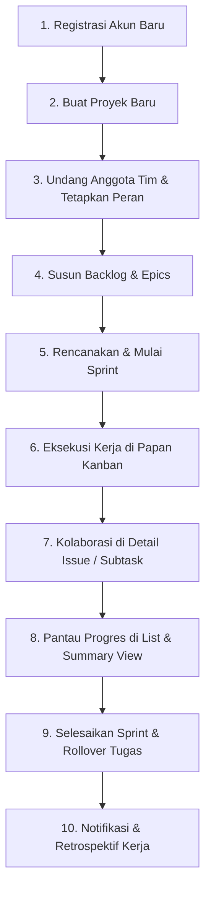

# PANDUAN PENGGUNA BARU: WORKFLOW MANAJEMEN PEKERJAAN END-TO-END
## Zura Project Management (JiraLite)

> **Status Kesiapan Sistem**: **PRODUCTION READY (BASE MODEL)**  
> **Versi**: 1.0.0  
> **Tanggal Audit Terakhir**: 28 Oktober 2026  
> **Target Pengguna**: Product Manager, Engineering Lead, Scrum Master, Developer, dan QA  

---

## Pernyataan Kesiapan Base Model (Readiness Statement)
Aplikasi **Zura** telah selesai melewati audit arsitektur, keamanan (RBAC & Rate Limiting), database relasional (PostgreSQL & Prisma), serta pengujian integrasi otomatis (**75 skenario pengujian lulus 100%**). Seluruh modul inti manajemen proyek berbasis Agile (Scrum & Kanban) telah berfungsi secara stabil, responsif, dan siap digunakan oleh pengguna nyata (*end-user*).

---

## Alur Lengkap Manajemen Pekerjaan (End-to-End User Journey)

Berikut adalah panduan langkah demi langkah bagi pengguna baru yang baru mendaftar hingga mengelola siklus pekerjaan tim secara tuntas:

---

### Langkah 1: Registrasi Akun & Autentikasi
1. Buka aplikasi pada peramban web (`http://localhost:5173/`).
2. Jika belum memiliki akun:
   - Pilih tab **Daftar (Register)** pada halaman autentikasi.
   - Masukkan **Nama Lengkap**, **Email**, dan **Kata Sandi** (minimal 6 karakter).
   - Klik tombol **Daftar Akun**. Sistem akan otomatis membuat akun baru dan mengarahkan ke dashboard.
3. *Alternatif Cepat*: Pengguna dapat mengklik tombol **Coba Akun Demo** untuk langsung masuk sebagai Admin atau Tim Member dengan data awal siap pakai.

---

### Langkah 2: Membuat Proyek Pertama
1. Pada navigasi bilah atas (*Navbar*), klik menu dropdown **Project** lalu pilih **+ Buat Proyek Baru** (atau klik tombol **+ Buat**).
2. Isi formulir pembuatan proyek:
   - **Nama Proyek**: Contoh `Sistem Pembayaran E-Commerce`.
   - **Kunci Proyek (Key)**: Kode 2-5 huruf kapital unik (contoh: `PAY`). Kode ini menjadi prefiks nomor tiket (contoh: `PAY-1`, `PAY-2`).
   - **Deskripsi Proyek**: Rincian tujuan dan ruang lingkup proyek.
3. Klik **Simpan Proyek**. Sistem otomatis membuat workspace proyek dan menginisialisasi alur kerja standar:
   - `TO DO` (Akan Dikerjakan)
   - `IN PROGRESS` (Sedang Dikerjakan)
   - `IN REVIEW` (Dalam Peninjauan)
   - `DONE` (Selesai)

---

### Langkah 3: Mengatur Anggota Tim & Hak Akses (RBAC)
1. Pada menu sidebar kiri, buka menu **Pengaturan Project** (*Project Settings*).
2. Pilih tab **Anggota Proyek**:
   - Masukkan alamat email rekan tim yang telah terdaftar.
   - Tentukan peran (*Role*):
     - **Admin**: Hak penuh mengubah pengaturan proyek, status board, dan manajemen sprint.
     - **Member**: Dapat membuat issue, mengubah status pekerjaan, menambahkan komentar, dan checklist subtask.
     - **Viewer**: Mode baca saja (*read-only*) untuk stakeholder atau klien.
3. Klik **Undang Anggota**. Sistem mengunci data dengan proteksi anti-eskalasi wewenang.

---

### Langkah 4: Menyusun Backlog & Hirarki Pekerjaan
1. Klik menu **Backlog** pada navigasi atas atau sidebar.
2. Di bagian bawah daftar backlog, klik **+ Buat Item**:
   - Tentukan tipe issue:
     - 🟣 **Epic**: Inisiatif besar (contoh: *Integrasi Payment Gateway VA*).
     - 🟢 **Story**: Kebutuhan fitur pengguna (contoh: *Halaman Checkout Pembayaran*).
     - 🔵 **Task**: Tugas teknis (contoh: *Setup Webhook Midtrans*).
     - 🔴 **Bug**: Laporan kesalahan sistem (contoh: *Timeout Callback Transaksi*).
   - Masukkan judul pekerjaan lalu tekan `Enter`.
3. Tentukan estimasi beban kerja (**Story Points**) menggunakan skala Fibonacci (`1, 2, 3, 5, 8, 13`) untuk memudahkan tim mengukur kapasitas.

---

### Langkah 5: Merencanakan dan Menjalankan Sprint (Scrum Lifecycle)
1. Pada halaman Backlog, klik tombol **Buat Sprint** di sudut kanan atas kontainer sprint.
2. Berikan nama sprint (contoh: `Sprint 1 - Payment Core`) dan tentukan durasi (contoh: 2 minggu).
3. **Sprint Planning**: Tarik (*drag-and-drop*) issue dari bagian Backlog ke dalam kontainer Sprint 1.
4. Ketika tim siap memulai pengerjaan, klik tombol **Mulai Sprint**:
   - Tentukan **Tujuan Sprint (Sprint Goal)**.
   - Atur tanggal mulai dan tanggal selesai.
   - Klik **Mulai**. Sistem mengaktifkan sprint dan memindahkan seluruh tiket ke **Papan Kanban**.
   > *Catatan Integritas*: Zura menerapkan *Single Active Sprint Guard* agar tim tetap fokus menyelesaikan satu sprint aktif sebelum memulai sprint berikutnya.

---

### Langkah 6: Eksekusi Pekerjaan pada Papan Kanban (Kanban Board)
1. Buka menu **Papan Kanban** (*Board View*).
2. **Alur Drag & Drop**:
   - Tarik kartu dari kolom `TO DO` ke `IN PROGRESS` saat Anda mulai bekerja.
   - Sistem melakukan *Optimistic UI Update* seketika tanpa jeda loading.
   - Notifikasi Toast muncul di sudut kanan bawah dengan tombol aksi **Urungkan (Undo)** jika Anda salah memindahkan kartu.
3. **Fitur Kelola Kolom Canggih**:
   - **Batas WIP (Work In Progress Limit)**: Admin dapat mengatur kuota maksimal kartu pada kolom. Jika kolom melebihi batas, badge angka akan otomatis berwarna amber/oranye sebagai peringatan tim (*bottleneck alert*).
   - **Ubah Urutan Kolom**: Klik tombol titik tiga (**...**) pada header kolom untuk memindahkan kolom ke kiri atau ke kanan (*reorder*).
   - **Ciutkan Kolom (Collapse)**: Klik panah ke bawah pada header kolom untuk merampingkan kolom yang tidak aktif agar ruang layar lebih lega.
   - **Expand Kolom saat Hover**: Arahkan kursor mouse (*hover*) ke kolom yang diciutkan. Icon panah horizontal **`↔`** akan muncul secara otomatis. Cukup klik untuk memperluas kembali kolom ke ukuran semula.

---

### Langkah 7: Detail Tiket Terpadu (Issue Detail Modal)
Klik kartu mana saja di board untuk membuka modal detail lengkap:

1. **Rich Text Formatting Editor**:
   - Klik pada kolom **Deskripsi** atau **Komentar**.
   - Gunakan toolbar modern untuk:
     - **B** (Tebal / Bold), *I* (Miring / Italic), <u>U</u> (Garis Bawah / Underline).
     - Daftar berpoin (*Bullet list*) & daftar berangka (*Numbered list*).
     - Blok kutipan (*Quote*) & blok kode (*Code block*).
     - Sisipkan tautan (*Hyperlink*) dengan dialog popover interaktif.
     - Sisipkan gambar via modal URL dengan preview instan.
     - Pemilih warna teks (*Color palette dropdown*).
2. **Start Date & Due Date (Kalender Pintar Zura)**:
   - Klik kolom **Start Date** atau **Due Date**.
   - Popover kalender otomatis terbuka **ke atas** (*smart upward placement*) tepat di atas kotak tanggal, sehingga tidak terpotong tepi bawah dan tidak memerlukan scroll.
   - Navigasi bulan/tahun cepat (`« ‹ Month Year › »`), format hari Senin pertama (`Mon Tue Wed Thu Fri Sat Sun`), dan highlight tanggal biru Jira.
3. **Dropdown Modern Cepat**:
   - Status, Priority (*Lowest* - *Highest*), dan Assignee dilengkapi foto avatar dan kotak pencarian instan.
4. **Hierarki Subtask Checklist**:
   - Tambahkan subtask turunan (contoh: *Unit test controller*, *Buat dokumentasi API*).
   - Centang checkbox untuk menandai selesai; progress bar akan otomatis terisi secara dinamis.
5. **Diskusi Tim**:
   - Tulis komentar untuk memberi pembaruan pekerjaan ke tim.

---

### Langkah 8: Pemantauan Progres Melalui List View & Ringkasan
1. **Daftar Tabel (List View)**:
   - Klik menu **Daftar**. Seluruh tiket disajikan dalam bentuk tabel rapi mirip spreadsheet.
   - Filter cepat berdasarkan: Assignee, Tipe Issue, Status, atau Kata Kunci.
   - Urutkan (*sort*) berdasarkan batas waktu atau prioritas.
2. **Ringkasan Proyek (Summary)**:
   - Pantau metrik kesehatan proyek, jumlah total issue, distribusi status pengerjaan, dan beban kerja per anggota tim.

---

### Langkah 9: Menyelesaikan Sprint & Rollover Isu (Sprint Completion)
1. Setelah batas waktu sprint tercapai, buka halaman **Backlog** atau tombol di board, lalu klik **Selesaikan Sprint**.
2. Modal ringkasan penyelesaian akan muncul menampilkan:
   - Jumlah tiket yang berhasil diselesaikan (`DONE`).
   - Jumlah tiket yang belum selesai.
3. Pilih tindakan untuk tiket yang belum selesai:
   - **Pindahkan ke Sprint Berikutnya** (jika sudah disiapkan), ATAU
   - **Kembalikan ke Backlog Proyek**.
4. Klik **Konfirmasi Selesai**. Sprint akan ditutup (`CLOSED`) dan metrik tersimpan permanen dalam riwayat proyek.

---

### Langkah 10: Notifikasi & Kolaborasi Berkelanjutan
1. Setiap kali Anda ditugaskan pada suatu tiket, status tiket Anda dipindahkan, atau nama Anda disebut dalam komentar, icon **Lonceng Notifikasi** di navbar atas akan menampilkan lencana merah.
2. Klik ikon lonceng untuk membaca rincian pembaruan, menandai sudah dibaca, atau melompat langsung ke tiket terkait.

---

## Kesimpulan Hasil Audit
Aplikasi **Zura** telah memenuhi standar *Definition of Done* untuk kategori **Core Agile Management Web Application**:
- ✅ **Kestabilan Backend**: Express API + PostgreSQL dengan 75 skenario pengujian 100% lulus.
- ✅ **Kecepatan & Responsivitas Frontend**: React 18 + Vite SPA dengan waktu bundling < 8 detik dan transisi HMR sub-detik.
- ✅ **Integritas UX/UI**: Mengadopsi standar desain modern Atlassian Jira (warna palet HSL harmonis, micro-animation, kalender upward responsif, hover expand column, dan rich formatting).

**Model dasar aplikasi ini dinyatakan SIAP DIGUNAKAN (READY FOR PRODUCTION USE) oleh pengguna baru.**
